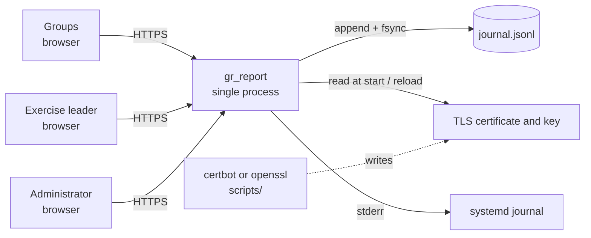
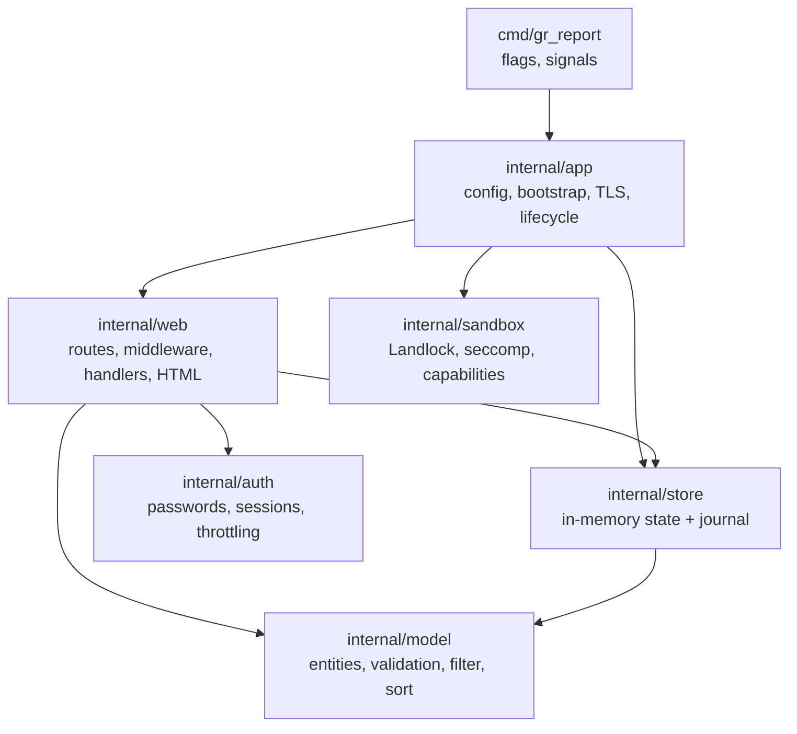
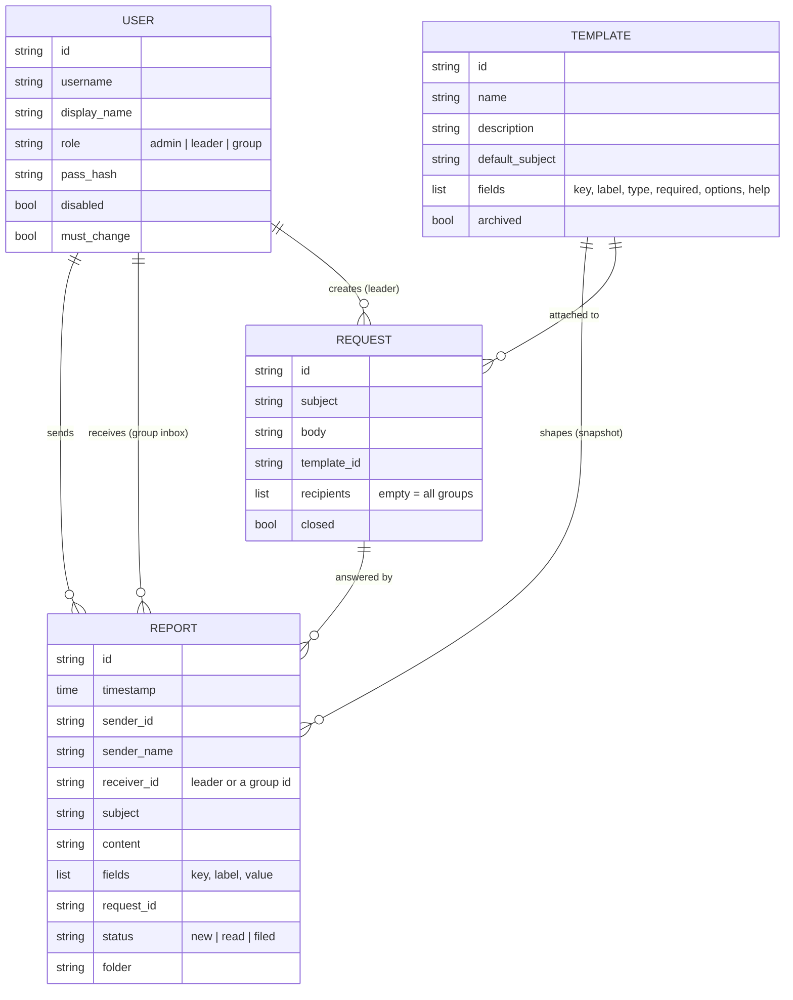
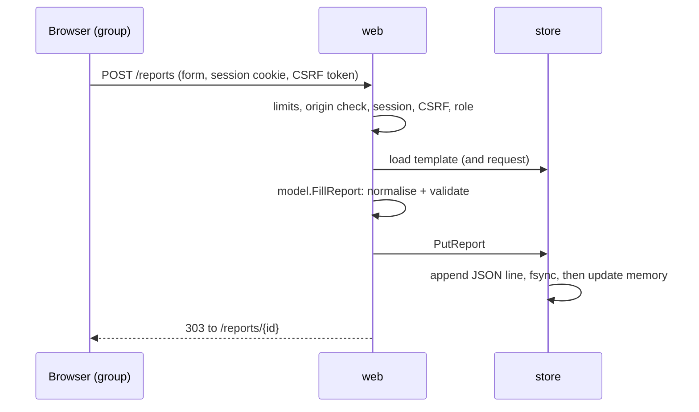
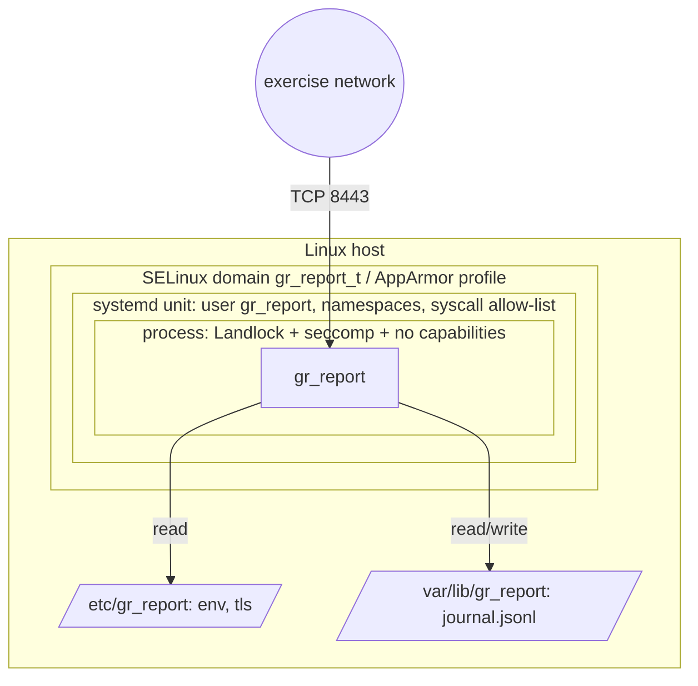

# Architecture

## Context



gr_report is one process serving HTML over HTTPS. It makes no outbound
connections and talks to no other service. Its only persistent state is one
file.

## Building blocks



| Package | Responsibility | Depends on |
| --- | --- | --- |
| `cmd/gr_report` | Process entry: parse flags, install signal handlers, exit code | `app` |
| `internal/app` | Configuration, first-run bootstrap, TLS loading and reload, start-up order, graceful shutdown | all below |
| `internal/web` | HTTP routing, security headers, authentication and authorisation middleware, handlers, embedded templates and CSS | `auth`, `store`, `model` |
| `internal/auth` | Password hashing and policy, session table, login throttling | – |
| `internal/store` | Thread-safe in-memory state, durable append-only journal, replay and compaction | `model` |
| `internal/model` | Domain types, input normalisation and validation, report filter and sort | – |
| `internal/sandbox` | Self-confinement on Linux, no-op elsewhere | – |

Dependencies point downwards only. `model`, `auth` and `sandbox` have no
dependencies inside the module, and the module has no dependencies outside
the Go standard library.

## Domain model



* The receiver `leader` is a pseudo ID for the queue shared by all exercise
  leaders. Any other receiver is the ID of a group.
* A report stores the sender's display name, the template name and the
  field labels as they were when it was sent, so later changes to accounts
  or templates do not rewrite history.
* Only `status` and `folder` of a report ever change; they belong to the
  receiver's handling of the report, not to the report itself.

## Queues

A queue is not a stored object. It is the set of reports with a given
receiver, optionally narrowed to one sender:

* leader queue = reports with receiver `leader`; "one queue per group" =
  the same set filtered by sender, with counters per sender;
* group inbox = reports whose receiver is that group.

Filter, search, sort and paging are applied to that set on each request.

## Runtime view

### Start-up

```mermaid
sequenceDiagram
  participant M as main
  participant A as app
  participant S as store
  participant K as kernel
  M->>A: ParseConfig (flags, env)
  A->>S: Open(data dir): lock, replay journal, compact
  A->>S: Bootstrap (first run: admin + starter templates)
  A->>A: load TLS certificate
  A->>K: listen on address
  A->>K: sandbox.Apply: no_new_privs, drop caps, Landlock, seccomp
  A->>A: serve; log sandbox status
```

The order matters: the sandbox is applied after everything that needs
privileges or wide file access is done, and before any request is read.

### Sending a report



A write is acknowledged only after `fsync`. If the append fails, memory is
not changed and the user gets an error.

### Certificate renewal

`SIGHUP` (`systemctl reload`) makes `app` re-read the certificate files.
The TLS directory stays readable under Landlock for exactly this purpose.
A failed reload keeps the current certificate.

## Deployment view



For development (`make dev`), the same binary runs in the foreground with
plain HTTP on localhost and a local `./data` directory; on macOS the
sandbox layers are absent.

## Cross-cutting concepts

* **Validation at the edge, once.** All user input passes through
  `model` (`CleanLine`, `CleanText`, `Validate`, `FillReport`) before it is
  stored. The store only checks structural validity.
* **Output escaping.** All HTML is produced by `html/template`.
* **Authorisation.** Route-level role lists in `web.Handler`, plus
  object-level checks in the handlers that load a report or request.
* **Time.** The clock is injected (`Server.Now`, `Sessions.Now`,
  `Limiter.Now`); timestamps are stored and shown in UTC.
* **Errors.** Validation errors re-render the form with status 422 and the
  input preserved; storage errors give 500 and are logged; nothing is
  half-applied.
* **Logging.** Structured `log/slog` text on stderr; `msg=audit` lines for
  security-relevant events. Passwords and tokens are never logged.

## Risks and technical debt

| Item | Consequence | Possible remedy |
| --- | --- | --- |
| All state in memory | RAM grows with the number of reports | Move reports to an embedded database ([ADR 0003](adr/0003-journal-storage.md)) |
| Sessions in memory | Restart logs users out | Persist sessions in the journal |
| No live updates | The leader sees new reports on reload or the 60 s auto-refresh | Server-sent events with a small, CSP-compatible script |
| Shared group accounts | No per-person audit trail | Personal accounts with group membership |
| SELinux/AppArmor not exercised in CI | Policy errors show up at deployment | Add a VM-based test job |
