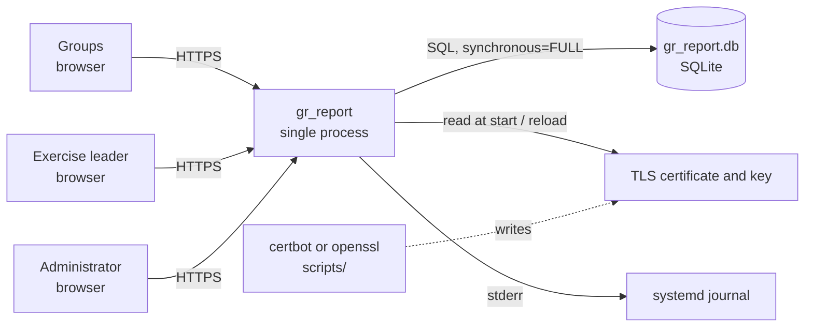
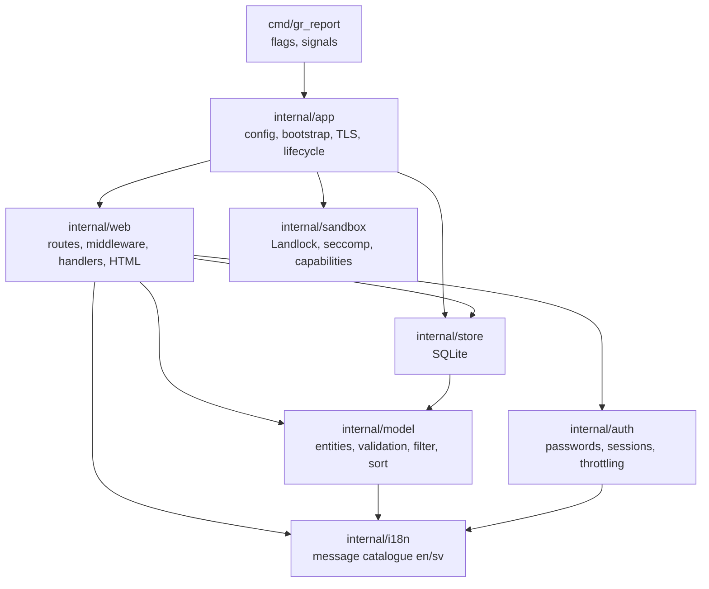
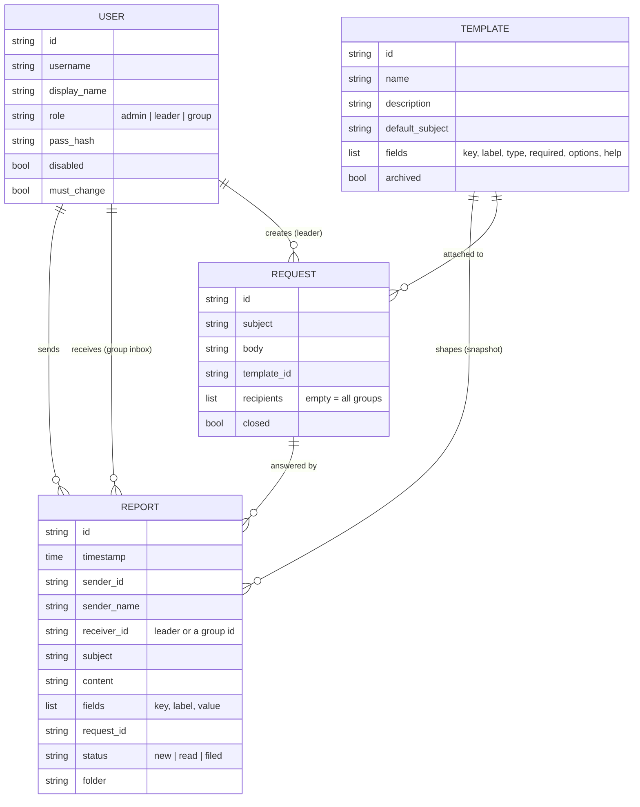
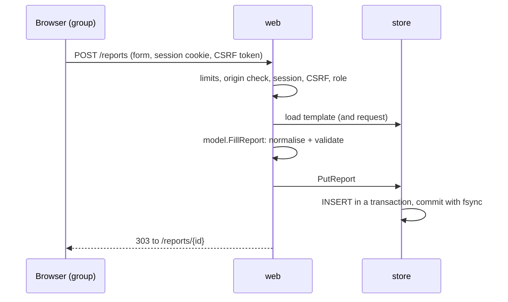

# Architecture

## Context



gr_report is one process serving HTML over HTTPS. It makes no outbound
connections and talks to no other service. Its only persistent state is one
SQLite database, accessed in-process.

## Building blocks



| Package | Responsibility | Depends on |
| --- | --- | --- |
| `cmd/gr_report` | Process entry: parse flags, install signal handlers, exit code | `app` |
| `internal/app` | Configuration, first-run bootstrap, TLS loading and reload, start-up order, graceful shutdown | all below |
| `internal/web` | HTTP routing, security headers, authentication and authorisation middleware, language and theme preferences, handlers, embedded templates, stylesheet (themes) and script | `auth`, `store`, `model`, `i18n` |
| `internal/auth` | Password hashing and policy, session table, login throttling | `i18n` |
| `internal/store` | SQLite database: schema migrations, queries, search | `model` |
| `internal/model` | Domain types, input normalisation and validation, report filter and sort | `i18n` |
| `internal/i18n` | Message catalogue (English keys, Swedish translations), translatable errors, language negotiation | – |
| `internal/sandbox` | Self-confinement on Linux, no-op elsewhere | – |

Dependencies point downwards only. `i18n` and `sandbox` are leaves. The
only third-party code in the binary is the pure-Go SQLite driver used by
`store` ([ADR 0010](adr/0010-vetted-dependencies.md)).

## Domain model



* The receiver `leader` is a pseudo ID for the queue shared by all exercise
  leaders. Any other receiver is the ID of a group.
* A report stores the sender's display name, the template name and the
  field labels as they were when it was sent, so later changes to accounts
  or templates do not rewrite history.
* Only `status` and `folder` of a report ever change; they belong to the
  receiver's handling of the report, not to the report itself.

### Chat

Chat is deliberately separate from reports. A **party** is a group account
or the exercise leaders collectively. A **conversation** is either `all`
or the unordered pair of two parties; it is a key computed on the fly, not
a stored object. `chat_messages` holds immutable messages with a sequence
number; `chat_read` holds, per party and conversation, the last sequence
number seen. See [ADR 0016](adr/0016-chat.md). Each message between two
groups also records whether it was sent under leader oversight
([ADR 0017](adr/0017-chat-oversight.md)).

## Queues

A queue is not a stored object. It is the set of reports with a given
receiver, optionally narrowed to one sender:

* leader queue = reports with receiver `leader`; "one queue per group" =
  the same set filtered by sender, with counters per sender;
* group inbox = reports whose receiver is that group.

Filter, search, sort and paging are applied to that set on each request.

## Runtime view

### Start-up

```mermaid
sequenceDiagram
  participant M as main
  participant A as app
  participant S as store
  participant K as kernel
  M->>A: ParseConfig (flags, env)
  A->>S: Open(data dir): lock, open database, migrate schema, integrity check
  A->>S: Bootstrap (first run: admin + starter templates)
  A->>A: load TLS certificate
  A->>K: listen on address
  A->>K: sandbox.Apply: no_new_privs, drop caps, Landlock, seccomp
  A->>A: serve; log sandbox status
```

The order matters: the sandbox is applied after everything that needs
privileges or wide file access is done, and before any request is read.

### Sending a report



A write is acknowledged only after the commit is on disk. If it fails,
nothing is stored and the user gets an error.

### Rendering a page

Each request resolves a language (cookie, then `Accept-Language`, then the
server default) and a theme (cookie, default `auto`). Handlers produce
messages as keys; the page template translates them with the request's
language and sets `<html lang="…" data-theme="…">`. The stylesheet maps the
theme name to a set of colours. The optional script polls
`/api/new-count` and reveals a notice when reports arrive.

### Certificate renewal

`SIGHUP` (`systemctl reload`) makes `app` re-read the certificate files.
The TLS directory stays readable under Landlock for exactly this purpose.
A failed reload keeps the current certificate.

## Deployment view


For development (`make dev`), the same binary runs in the foreground with
plain HTTP on localhost and a local `./data` directory; on macOS the
sandbox layers are absent.

## Cross-cutting concepts

* **Validation at the edge, once.** All user input passes through
  `model` (`CleanLine`, `CleanText`, `Validate`, `FillReport`) before it is
  stored. The store only checks structural validity.
* **Output escaping.** All HTML is produced by `html/template`.
* **Language.** Messages are English keys translated at the edge
  ([ADR 0013](adr/0013-internationalisation.md)); user-written content is
  shown as written.
* **Accessibility and themes.** Semantic markup and contrast-checked colour
  sets, enforced by tests ([ADR 0014](adr/0014-accessibility-and-themes.md)).
* **Authorisation.** Route-level role lists in `web.Handler`, plus
  object-level checks in the handlers that load a report or request.
* **Time.** The clock is injected (`Server.Now`, `Sessions.Now`,
  `Limiter.Now`); timestamps are stored and shown in UTC.
* **Errors.** Validation errors re-render the form with status 422 and the
  input preserved; storage errors give 500 and are logged; nothing is
  half-applied.
* **Logging.** Structured `log/slog` text on stderr; `msg=audit` lines for
  security-relevant events. Passwords and tokens are never logged.

## Risks and technical debt

| Item | Consequence | Possible remedy |
| --- | --- | --- |
| Queue views sort in memory | A view loads all matching rows before paging | Move sorting and `LIMIT` into SQL ([ADR 0012](adr/0012-sqlite-storage.md)) |
| Sessions in memory | Restart logs users out | Persist sessions in the database |
| New-report notice and chat by polling | Up to 30 s (notice) or 4 s (chat) delay; a request per open chat page every 4 s | Server-sent events |
| No moderation of chat | Misuse can only be met by disabling an account or the chat; oversight (optional) only reads | Message removal by the leader |
| Oversight view is not live | A leader following a conversation must reload | Poll the oversight view like a normal conversation |
| Page script untested by automation | A regression shows up only in manual use | Browser test job in CI |
| No screen-reader review | Markup checks cannot prove the experience | Manual audit with assistive technology |
| Shared group accounts | No per-person audit trail | Personal accounts with group membership |
| SELinux/AppArmor not exercised in CI | Policy errors show up at deployment | Add a VM-based test job |
