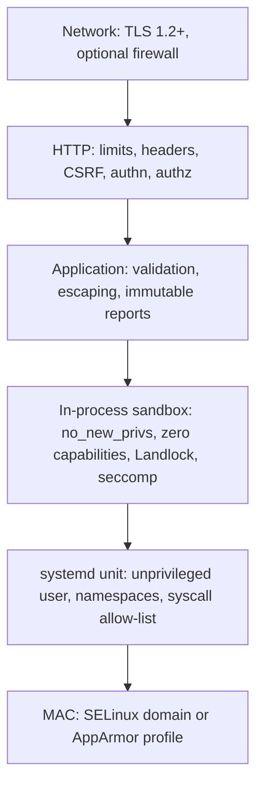

# Security

## What is protected

* **Confidentiality of reports** between groups: a group must only read
  what it sent or received.
* **Integrity of reports**: sender and timestamp are set by the server and a
  sent report cannot be altered.
* **Credentials**: passwords, session tokens, the TLS private key.
* **The host**: a flaw in gr_report must not become a foothold on the
  machine it runs on.

## Threats considered

| Threat | Counter-measures |
| --- | --- |
| Eavesdropping or tampering on the exercise network | TLS mandatory by default, TLS ≥ 1.2, HSTS, `Secure` cookies |
| Password guessing | Argon2id (19 MiB, 2 passes; [ADR 0015](adr/0015-argon2id.md)) with at most 4 concurrent derivations, older PBKDF2 hashes upgraded at login, login throttling per account+address and per address, generated one-time passwords, uniform timing for unknown users |
| Session theft / fixation | 256-bit random token, only its SHA-256 is kept in memory, `HttpOnly`, `SameSite=Strict`, `__Host-` prefix, new token at login, idle and absolute time-outs, all sessions revoked on password change/reset/disable |
| Cross-site request forgery | Per-session token in every form, `Sec-Fetch-Site`/`Origin` check on every POST, `SameSite=Strict` |
| Cross-site scripting, content injection | Contextual escaping by `html/template`; CSP `default-src 'none'` with only same-origin script, styles and images – no inline script, style or event handler, no `eval`; the one script never inserts HTML; `nosniff`; theme and language preferences are validated against fixed lists before they reach a page |
| SQL injection | Every value is a bound parameter, no SQL text is built from input; `LIKE` wildcards in search terms are escaped; a fuzz target cross-checks the SQL search against a reference matcher |
| Click-jacking | `frame-ancestors 'none'`, `X-Frame-Options: DENY` |
| A participant reading or changing another group's data | Role check on every route, object-level check on every report and request, queue actions limited to the user's own queue |
| Forged sender or time | Both are taken from the session and the server clock, never from the form – for reports and chat messages alike |
| Reading someone else's chat | A conversation is derived from the requester's own party and the peer in the URL; a conversation one is not part of cannot be named |
| Chat flooding | 20 messages per user per minute, 2 000 characters per message, the general request limits |
| Script injection through chat | Messages are escaped by the template; the script appends new ones with `textContent` only |
| Resource exhaustion | Request body limit 256 KiB, header limit 32 KiB, read/write/idle time-outs, field length limits, bounded session and throttle tables, `MemoryMax`/`TasksMax` in the unit |
| Corrupt stored data | SQLite integrity check at start; `STRICT` tables; a file that is not a database is refused, never overwritten; a damaged row fails loudly instead of being shown half-read |
| Remote code execution in the server | Memory-safe language, no cgo and no C library in the process, and the sandbox layers below |
| Supply-chain compromise | Two runtime dependencies (the pure-Go SQLite driver and `golang.org/x/crypto`) with pinned, checksummed versions ([ADR 0010](adr/0010-vetted-dependencies.md)); the web interface has no third-party script, style or font |

Out of scope: a malicious administrator or root user on the server, denial
of service by flooding the network, and compromised participant devices.

## Roles and authorisation

| Action | group | leader | admin |
| --- | --- | --- | --- |
| Write a report, answer a request | ✔ | | |
| Read a report | own sent / received | all | |
| Change status / folder of a report | own inbox | leader queue | |
| Send and close requests | | ✔ | |
| Chat: shared conversation | ✔ | ✔ | |
| Chat: direct conversation | own group's | those with the leader | |
| Create, edit, archive templates | | ✔ | ✔ |
| Manage accounts | | | ✔ |

The administrator deliberately has no access to reports or chat. The
exercise leader cannot read a direct conversation between two groups
([ADR 0016](adr/0016-chat.md)).

## Defence in depth

A request has to get past every layer; each layer is independent of the
others.

### In-process sandbox

Applied by the server itself after the data directory, the certificate and
the listening socket are open, and before the first connection is accepted
(`internal/sandbox`):

| Mechanism | Effect |
| --- | --- |
| `RLIMIT_CORE=0`, `PR_SET_DUMPABLE=0` | No core dumps, no ptrace attach by same-user processes |
| `PR_SET_NO_NEW_PRIVS` | No privilege gain through setuid or file capabilities |
| Capabilities | Bounding, ambient, effective, permitted and inheritable sets emptied (after the port is bound) |
| Landlock, file system | Everything denied except: data directory read/write (regular files only – enough for SQLite's database, `-wal` and `-shm` files), TLS directories read-only |
| Landlock, network (kernel ≥ 6.7) | Every new TCP `bind` and `connect` denied; abstract UNIX sockets scoped (≥ 6.12) |
| seccomp-BPF | Deny-list, see below |

The seccomp filter makes these system calls fail with `EPERM` and kills the
process on a foreign ABI (32-bit or x32 calls):

* program execution: `execve`, `execveat`
* new sockets and connections: `socket`, `socketpair`, `connect`, `bind`,
  `listen`
* identity: `setuid`, `setgid`, `setreuid`, `setregid`, `setresuid`,
  `setresgid`, `setgroups`, `setfsuid`, `setfsgid`
* debugging and other processes: `ptrace`, `process_vm_readv`,
  `process_vm_writev`, `kcmp`, `pidfd_getfd`, `perf_event_open`
* kernel and mounts: `mount`, `umount2`, `pivot_root`, `chroot`,
  `open_tree`, `move_mount`, `fsopen`, `fsconfig`, `fsmount`, `fspick`,
  `mount_setattr`, `init_module`, `finit_module`, `delete_module`,
  `kexec_load`, `kexec_file_load`, `bpf`, `userfaultfd`, `reboot`,
  `swapon`, `swapoff`, `iopl`, `ioperm`
* namespaces and keys: `unshare`, `setns`, `keyctl`, `add_key`,
  `request_key`
* miscellaneous: `io_uring_*`, `open_by_handle_at`, `name_to_handle_at`,
  `mknod`, `mknodat`, `acct`, `quotactl`, `personality`, `vhangup`,
  `syslog`, `settimeofday`, `clock_settime`, `adjtimex`, `clock_adjtime`,
  `sethostname`, `setdomainname`

The system call numbers in `internal/sandbox/seccomp_linux_*.go` were
generated from the kernel UAPI headers (`asm/unistd_64.h` for amd64,
`asm-generic/unistd.h` for arm64). The in-process filter is a deny-list
because the set of calls the Go runtime needs changes between Go releases;
the allow-list is the `SystemCallFilter=` of the systemd unit
([ADR 0006](adr/0006-layered-sandbox.md)).

Modes (`-sandbox`):

* `auto` (default) – apply everything the kernel supports and log what is
  missing.
* `strict` – refuse to start unless every mechanism is active. This is the
  setting in the shipped `gr_report.env`.
* `off` – development only.

On macOS there is no in-process sandbox; the server logs that fact and
`strict` refuses to start.

### systemd

`deploy/systemd/gr_report.service` runs the server as the unprivileged
user `gr_report` with, among others: `NoNewPrivileges`, an empty
`CapabilityBoundingSet`, `PrivateUsers`, `ProtectSystem=strict`,
`ProtectHome`, `PrivateTmp`, `PrivateDevices`, `ProtectProc=invisible`,
`ProtectKernel*`, `RestrictNamespaces`, `RestrictAddressFamilies=AF_INET
AF_INET6`, `MemoryDenyWriteExecute`, `SystemCallArchitectures=native`,
`SystemCallFilter=@system-service @sandbox` minus `@privileged
@resources`, `LimitCORE=0`, `MemoryMax` and `TasksMax`. The only writable
path is `/var/lib/gr_report`.

### SELinux

`deploy/selinux/` defines the domain `gr_report_t`. It may read
`gr_report_etc_t` (configuration, TLS), manage `gr_report_var_lib_t`
(data) and bind TCP sockets to `gr_report_port_t` or unprivileged
`http_port_t` ports. There is no rule to execute anything, connect out or
read other files. Binding privileged ports is behind the boolean
`gr_report_bind_low_ports`.

### AppArmor

`deploy/apparmor/usr.local.bin.gr_report` allows reading `/etc/gr_report`,
read/write/lock in `/var/lib/gr_report` and TCP sockets; no execute rule
exists, so no program can be started.

## What has been verified, and how

| Layer | Verification |
| --- | --- |
| Landlock, seccomp, capabilities, no_new_privs | Automated: `internal/sandbox` runs a child process under the sandbox and asserts that exec, sockets, connect, ptrace, setuid, writes outside the data directory and reads of `/etc/passwd` fail while writes to the data directory keep working; `cmd/gr_report` runs the real binary sandboxed through login, writes and a certificate reload |
| HTTP security controls | Automated integration tests (`internal/web`) for CSRF, origin checks, role and object access, cookie flags, headers, throttling, escaping |
| Parsers, validators, SQL search | Fuzz targets, see [testing.md](testing.md) |
| Sandbox with SQLite | The end-to-end test runs the real binary, with the SQLite engine, under Landlock and seccomp |
| systemd unit | `systemd-analyze verify` and `systemd-analyze security` (`make verify-deploy`). Not exercised by the automated tests under a running systemd |
| SELinux module | Compiles against the reference policy (`make verify-deploy`). **Not tested on an enforcing system** – run it in permissive mode first and check `ausearch -m avc` |
| AppArmor profile | Parses with `apparmor_parser` (`make verify-deploy`). **Not tested in enforce mode** – check `journalctl -k | grep DENIED` after first start |

## Known limitations

* Sessions live in memory: a restart logs everyone out.
* Group accounts are shared by the members of a group; there is no
  per-person accountability inside a group.
* Login CSRF is prevented by the origin check and `SameSite` only (there is
  no session to bind a token to before login).
* The client address used for throttling is the TCP peer. Behind a reverse
  proxy all users share one address; run gr_report directly on the network
  or accept coarser throttling.
* The database is not encrypted at rest; protect the disk and the backups.
  This includes every chat conversation: whoever can read the database
  file can read them, whatever the application's access rules say.
* Chat messages are not written to the log, but the log does record who
  sent a message in which conversation and when.
* The language and theme cookies (`gr_lang`, `gr_theme`) are not
  security-relevant; they are `HttpOnly`, `SameSite=Lax` and validated on
  every request.
* The page script is optional. With it, the guarantee against script
  injection rests on the CSP allowing only the server's own origin and on
  nothing user-controlled being served as script
  ([ADR 0011](adr/0011-progressive-enhancement.md)).

## Reporting a vulnerability

Open a private security advisory on the repository rather than a public
issue.
